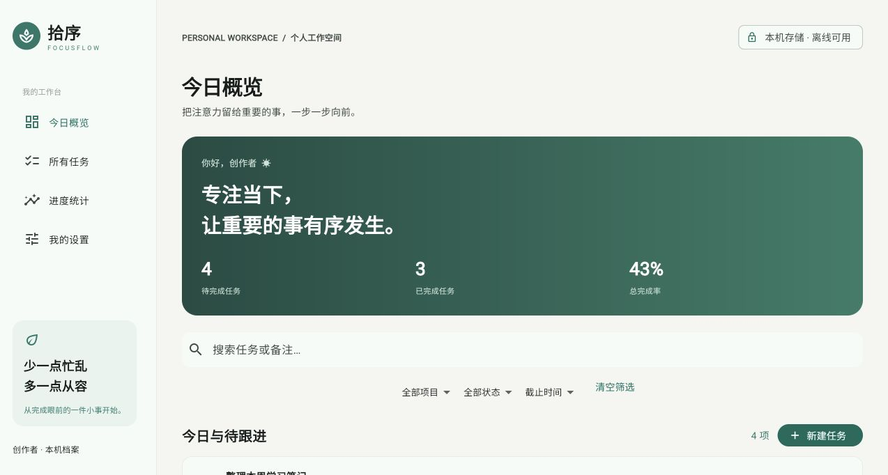
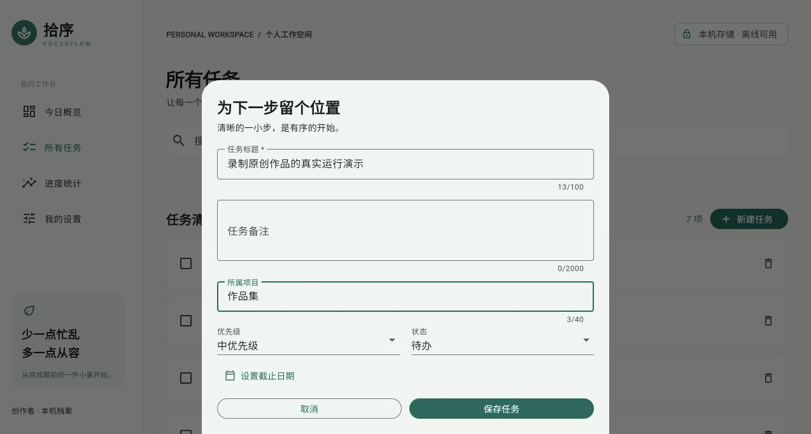

# 拾序 FocusFlow

个人原创 Flutter 任务管理作品。任务编辑、项目筛选、截止日期与完成状态、本地持久化、统计、主题和 JSON 备份形成完整流程。AI 辅助开发，示例任务为虚构内容；无真实客户或商业交付声明。

源码：[GitHub 仓库](https://github.com/yang1256149685/focusflow-flutter) · 在线体验：[打开演示](https://yang1256149685.github.io/focusflow-flutter/)（公开静态版）。




## 运行

验证使用 Flutter 3.41.9 / Dart 3.11.5。安装对应稳定版 SDK 后，从仓库根目录执行：

```bash
flutter pub get
flutter run -d chrome
```

首次运行自动载入原创示例任务。点击“新建任务”，填写标题、项目、优先级、状态与日期；点击列表项编辑，勾选完成，删除需确认。设置中的本机档案只是显示名，不是远程登录。

## 数据与备份

数据存于 shared_preferences（Web 为浏览器本机存储），不会发送任务到服务器。关闭页面、刷新后仍能读取；清空后不自动重新注入样例。保存失败不会假装成功。

设置 → 导出 JSON 可复制备份；恢复时粘贴 JSON 并确认替换，校验失败保留旧数据。不要填写密钥或敏感资料；本机明文存储并非加密保险箱。清理浏览器数据或无痕会话结束可能丢失任务，请定期备份。应用首次加载仍需要可访问资源，不能保证离线重新安装/首次打开。

## 测试与构建

```bash
flutter analyze
flutter test
flutter build web --release --base-href /focusflow-flutter/
flutter build apk --debug
```

Web 发布路径需与实际仓库名一致；Android 构建需要 Android SDK/JDK。调试 APK 仅供演示安装，不是应用商店正式发布版本。实际构建、运行平台和限制见 [测试记录](docs/testing.md)。iOS 标准工程已提供，但尚未构建、签名和运行验证。

## 结构

`lib/models/` 严格任务模型；`lib/data/` 可替换持久层；`lib/state/` 串行落盘与统计；`lib/main.dart` 响应式 UI；`test/` 业务与界面测试。参见 [架构说明](docs/architecture.md)、[部署说明](docs/deployment.md)、[猿急送案例资料](docs/case-study.md)、[截图证据](docs/evidence.json)。

没有多人同步、推送、支付、云端账号或企业安全能力。所有统计均根据当前任务计算。代码采用 MIT，依赖遵守各自许可证，Flutter 标准工程文件来自官方脚手架。自定义界面、标识与任务为本项目原创。
